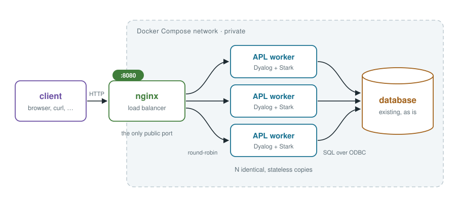

# Issues web service

A small clone of [GitHub's Issues REST API](https://docs.github.com/en/rest/issues), built to show how a Dyalog APL application fits into an ordinary web-service stack. It is meant for learning, not for production use.



Most of the stack is standard parts: the official `postgres` and `nginx` images, Docker Compose, unixODBC and the Postgres ODBC driver. The APL part, in `worker/app/`, is about 180 lines of code plus 110 lines of APLAN describing the API, on [Jarvis](https://dyalog.github.io/Jarvis/) and [Stark](https://dyalog-labs.github.io/stark/). It turns HTTP requests into SQL and hands back the JSON documents Postgres builds.

The accompanying blog post is in [`docs/post.md`](docs/post.md).

## Licence

The worker image downloads and installs **Dyalog APL** from dyalog.com while it builds. Dyalog is free for non-commercial use but is **not free software**. By building the image you accept Dyalog's licence terms: <https://www.dyalog.com/uploads/documents/Developer_Software_Licence.pdf>. The licence also ships inside the image at `/opt/mdyalog/20.0/64/unicode/LICENSE`. This repository contains no Dyalog software. Build images locally; don't publish them.

Stark (MIT licence) is pre-release software.

## Architecture

| Service | What it does | Image |
|---------|--------------|-------|
| `nginx` | The only entry point for API clients (port 8080). Round-robins requests across the workers, finds new workers automatically when you scale, and adds an `X-Worker` header naming the worker that answered. | `nginx:1.29`, configured by `nginx/nginx.conf` |
| `worker` ×N | Dyalog APL running Jarvis and Stark. Each worker validates the request, runs SQL with bound values, and returns the result. Workers are stateless and identical, so any of them can answer any request. | built from `worker/Dockerfile` |
| `postgres` | All data and rules. Views and functions build every JSON response, and triggers apply GitHub's close/reopen rules. | `postgres:17`, schema in `db/init/` |
| `console` | A browser app (Vue 3, no build step) that uses the API like any other client, with a log of every request it makes (port 3000). | `nginx:1.29`, serving `console/` |

A few design points:

- **The API copies GitHub's.** URLs, field names, status codes, error bodies and pagination are GitHub's, for one repository and without authentication.
- **The route table is the API description.** Each route in `worker/app/Service.apln` carries its OpenAPI metadata as APLAN, and Stark generates `/openapi.json` from it, so the documentation can't drift from the routing. The tests check real responses against that spec.
- **Failure is handled by restarting.** If a worker loses its database connection it exits, and Compose starts a fresh one (`restart: unless-stopped`).
- **Only nginx and the console publish ports.** The workers and the database are reachable only on the Compose network.

## Installation

You need Docker with Compose v2. The worker image builds natively on arm64 (including Apple Silicon) and x86-64. The first build downloads Dyalog and takes a few minutes; later builds are cached.

```bash
git clone https://github.com/xpqz/webservice.git
cd webservice
docker compose up -d --build --scale worker=3 --wait
db/seed/load.sh                     # optional: demo data, 40 real issues from Dyalog/link
```

On Windows, use Docker Desktop (it must be running) and run the commands in a WSL2 distribution with Docker Desktop's WSL integration turned on, or in Git Bash. In Git Bash, install jq (`winget install jqlang.jq`), and run `alias curl=/c/Windows/System32/curl.exe` before trying the examples below: Git's own curl turns non-ASCII characters in arguments into `?`. The scripts need bash, curl and jq, and run in either shell. The examples are bash and won't paste into PowerShell or cmd.

`--wait` returns once Postgres, the workers and nginx all report healthy. Then:

- **API:** <http://localhost:8080>, for example `curl -s localhost:8080/issues | jq .`
- **Console:** <http://localhost:3000>. It starts with the stack; your browser needs internet access to load Vue from a CDN.
- **API description:** <http://localhost:8080/openapi.json>. To browse it in Swagger UI:
  ```bash
  docker run --rm -p 8081:8080 -e URL=http://localhost:8080/openapi.json swaggerapi/swagger-ui
  ```
  and open <http://localhost:8081>.

To stop: `docker compose down`. Add `-v` to delete the data as well.

### Try it

```bash
curl -s -X POST localhost:8080/issues -H 'Content-Type: application/json' \
     -d '{"title":"⍳ fails on an empty argument","labels":["bug"]}'
curl -s -X PATCH localhost:8080/issues/41 -H 'Content-Type: application/json' -d '{"state":"closed"}'
curl -s 'localhost:8080/issues?state=all&labels=bug&sort=updated'
for i in 1 2 3; do curl -s -o /dev/null -D - localhost:8080/health | grep -i x-worker; done
```

(Issue 41 is the next number after the demo data.) Raw responses show non-ASCII characters as JSON escapes (`⍳` is `⍳`); pipe through `jq` to see them.

### Endpoints

| Method | Path |
|--------|------|
| GET, POST | `/issues` (list: `state`, `labels`, `sort` = `created`/`updated`, `per_page`, `page`) |
| GET, PATCH | `/issues/{number}` |
| GET, POST | `/issues/{number}/comments` |
| GET, POST | `/issues/{number}/labels` |
| DELETE | `/issues/{number}/labels/{name}` |
| GET, POST | `/labels` |
| GET, PATCH, DELETE | `/labels/{name}` |
| GET | `/health`, `/openapi.json` |

## Configuration

| Setting | Where | Default | Effect |
|---------|-------|---------|--------|
| `--scale worker=N` | `docker compose up` | 1 | Number of APL workers. Can be changed on a running stack; nginx picks up the change within 5 seconds. |
| `POSTGRES_PASSWORD` | environment or `.env` | `issues` | Database password, used by Postgres and the workers. Copy `.env.example` to `.env` to set it. |
| `API_PORT` | environment or `.env` | `8080` | Host port for the API. The console expects 8080, so change this only if you don't use the console. |
| `CONSOLE_PORT` | environment or `.env` | `3000` | Host port for the console. |
| `DYALOG_APL_VERSION` | build arg, `worker/Dockerfile` | `20.0.53963` | Dyalog version to install. Stark needs 20.0 or later. |
| `STARK_VERSION` | build arg, `worker/Dockerfile` | `v0.2.5` | Stark release to fetch. |

After changing APL code in `worker/`, rebuild with `docker compose up -d --build --scale worker=3 --wait`. The code is baked into the image. Console files are served straight from `console/`, so a browser reload is enough there.

The schema in `db/init/` runs only when the database volume is empty. After changing it, start over with `docker compose down -v`, bring the stack up again, and reload the demo data.

## Tests

```bash
test/ci.sh                          # all tests
test/ci.sh test_issue_create        # just some
```

`test/ci.sh` starts a separate copy of the stack, with its own database, on ports 18080 and 13000. It runs `test/smoke.sh` against it (bash, curl and jq, through nginx, the way a client sees the service) and removes the copy afterwards. Your running stack and its data are never touched. Two tests that restart containers run only when named: `test_manual_rescale` and `test_manual_postgres_restart`.

## Demo data

`db/seed/link-issues.json` is a snapshot of recent issues from [Dyalog/link](https://github.com/Dyalog/link): 25 open and 15 closed, with their labels and up to three comments each. Every body ends with a pointer to the original issue. `db/seed/load.sh` loads it through the API, so run it against an empty database. `db/seed/fetch.py` refreshes the snapshot; it needs the GitHub CLI (`gh`).

## Known limitations

- No authentication, no TLS, one repository.
- A label whose name contains `/` can be created but not reached at `/labels/{name}`, because Jarvis decodes `%2F` before Stark matches the route.
- An empty string in a PATCH means "leave unchanged", so a field can't be cleared.
- While Postgres restarts, requests fail for a few seconds until every worker has reconnected.
- JSON keys come back in alphabetical order.

## Repository layout

| Path | What |
|------|------|
| `compose.yaml` | the four services |
| `nginx/nginx.conf` | load balancing |
| `worker/Dockerfile` | Debian + Dyalog + unixODBC + Postgres ODBC driver + Stark |
| `worker/app/Run.apls` | boots a worker |
| `worker/app/Service.apln` | the route table, with each route's OpenAPI description in APLAN |
| `worker/app/Api.apln` | the handlers |
| `worker/app/Db.apln` | the database connection (SQAPL) |
| `db/init/01-schema.sql` | tables, triggers, and the views and functions that build JSON |
| `db/seed/` | demo data, and the scripts that fetch and load it |
| `console/` | the browser client: `api.js` (every REST call), `app.js` (Vue components) |
| `test/ci.sh`, `test/smoke.sh` | the tests |
| `docs/post.md`, `docs/figures/` | the blog post and its figures |
