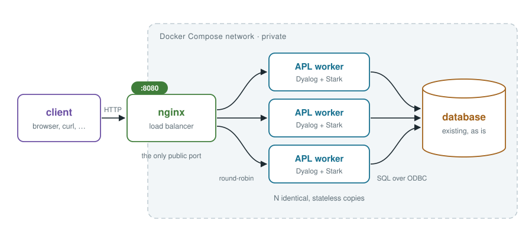
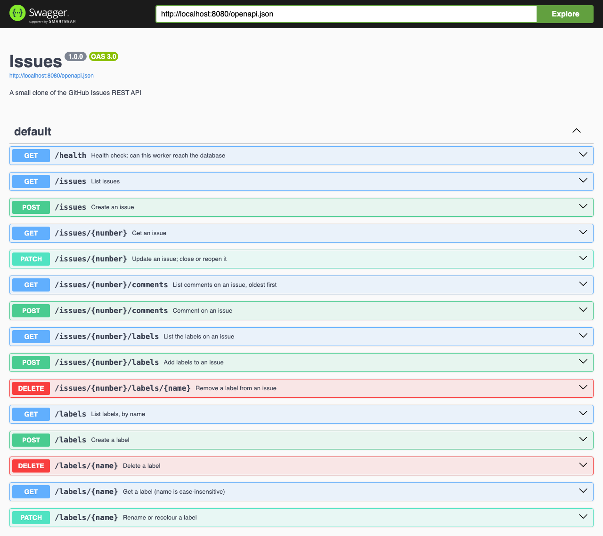
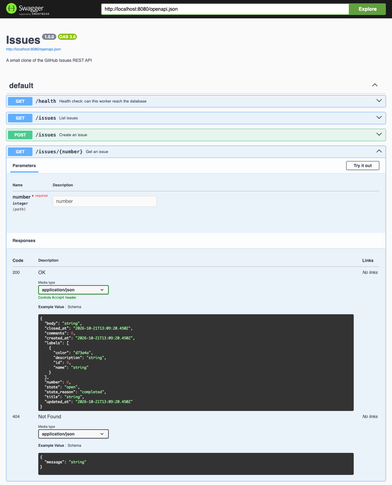
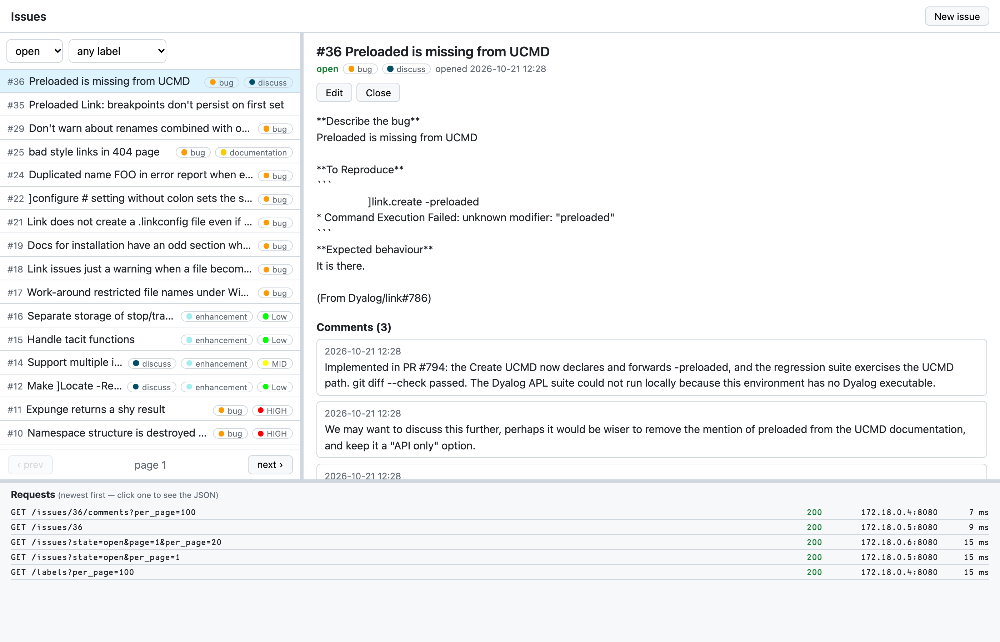
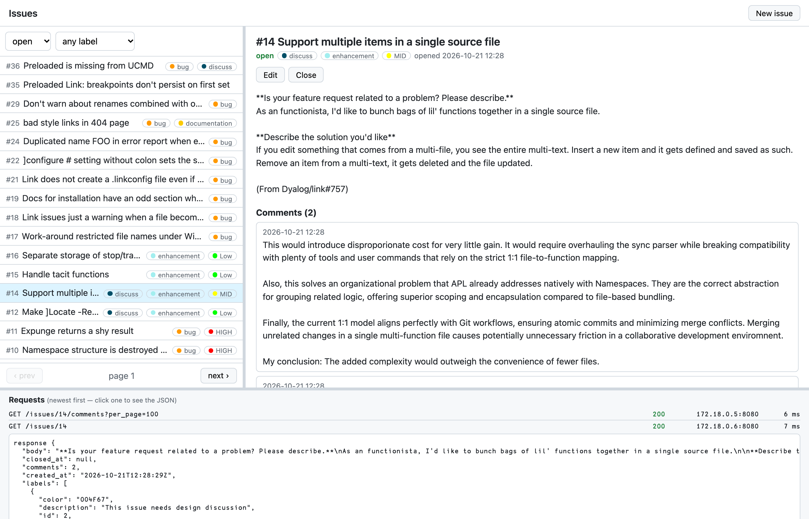

# An APL web service built from standard parts

By: stefan@dyalog.com

My aim today is to build a fairly complete, reasonably scalable, (but ultimately still a toy) webservice where Dyalog APL's [Jarvis](https://dyalog.github.io/Jarvis/) functions as the application server holding the main business logic. I want to demonstrate an architecture pattern, rather than the code itself in detail so that you could get started with exposing your particular business data via an API. The application we walk through below should be runnable; you can check out the final state in its GitHub repository, [xpqz/webservice](https://github.com/xpqz/webservice).

The title talks about "building from standard parts" -- what does that even mean? As APLers, traditionally, many of us choose to "live in the session", and build every aspect of our systems in APL. This approach has served us well, and the advantage is that an APLer then can retain a good working knowledge of every part of their system. The disadvantage is that we forego the investment and development that has gone into non-APL system building blocks, and that we risk re-inventing the wheel, or solving problems that has already been solved in other contexts. 

Service oriented systems today are often built from standard building blocks, a bit like lego bricks, requiring configuration only to piece together. Grab an off-the-shelf database, a load balancer, perhaps a message queue, distributed search, a firewall, run it in containers using an established orchestrator, drive it all from git etc. Systems built this way are said to be _composable_. 

An orchestrator lets you add or remove capacity as the need changes. The one we'll use today, [Docker Compose](https://docs.docker.com/compose/), runs everything on a single machine: scaling there means starting more processes on that host. Spreading the same containers across several machines, and surviving the loss of one, is what orchestrators like [Kubernetes](https://kubernetes.io/) are for; the containers we build here would move there unchanged. 

Of course, you can always write all of this in Dyalog APL; the tools are there. However, the "lego bricks" approach lets you focus on what _you_ know best: your own domain business logic. You don't have to spend time figuring out the best way to load balance Jarvis processes across multiple machines, or how to ensure you have no concurrency data races accessing your data. 

We're going to build our application using Docker Compose as our orchestration framework, [nginx](https://nginx.org/) as our reverse proxy/load balancer, [postgresql](https://www.postgresql.org/) as our data layer and [Jarvis](https://dyalog.github.io/Jarvis/) + [Stark](https://dyalog-labs.github.io/stark/) as our application server. I'll then show how you can build a simple UI in the [Vue](https://vuejs.org/) JavaScript framework to interact with our service. 

## Pre-requisites

I will assume broad familiarity with [HTTP](https://en.wikipedia.org/wiki/HTTP) and [JSON](https://www.json.org/) and that you are somewhat comfortable typing commands into a terminal. I will also assume you know your way around Jarvis, and -- needless to say -- Dyalog APL.

We're building this in Docker containers but won't go too deep on Docker beyond using it. I will be treating the database mostly as a black box, but if you are interested in its schema, you can examine that in the repository. If reading tiny bits of [SQL](https://en.wikipedia.org/wiki/SQL) doesn't put you off your breakfast, that helps, too.

Inevitably, this touches tools and components that are uncommon in use in typical APL shops. I will try to introduce such briefly and suggest further reading. Two tools we'll be calling on occasionally are [curl](https://curl.se/) and [jq](https://jqlang.org/). `curl` is a command-line HTTP client; think of it as Dyalog's [HttpCommand](https://dyalog.github.io/HttpCommand/), but for the terminal. 

`jq` is a command-line JSON processor -- it lets you filter and transform JSON data to pick out only the bits you care about. We won't use many of `jq`'s fancier features; it's mainly a JSON pretty-printer for us. Our test suite uses `jq`, but we won't look at that here.

If you're coding along, you may want to install those if they didn't come with your system already. 

> **Note**: if you're set up with [Docker Desktop on Microsoft Windows](https://docs.docker.com/desktop/setup/install/windows-install/), the stuff we're doing here "should just work". However, Docker on Windows already rely on [WSL2](https://learn.microsoft.com/en-us/windows/wsl/install), and you may just be better running in WSL2 directly. 

## The application

We're going to implement a subset of [GitHub's issues API](https://docs.github.com/en/rest/issues?apiVersion=2026-03-10). If you're unfamiliar with the issues system, you can think of it as a ticketing system for bugs, feature requests, tasks etc. An issue can be labelled, commented on, opened, closed, edited etc. This API is REST-based, and can be interacted with directly over HTTP, or via the [gh](https://cli.github.com/) command line utility. 

Why did we choose this? Well, for our purposes it's convenient to be able to target an existing API, rather than spending time inventing something new from scratch. As an example, it's large enough to justify the pattern, yet small enough to understand at a glance. 

Note that we won't be targetting GitHub itself: we'll have our own data store. We'll also skip or gloss over many hard parts that would balloon the scope of this blog post. For example, our application will be running unauthenticated and open; _not_ what you want for a real application. 

### Getting it running

To follow along, you need Docker with Compose, plus curl and jq. Clone the repository, start the stack with three workers, and load the demo data, a snapshot of 40 real issues from Dyalog's [Link](https://github.com/Dyalog/link) project:

```sh
git clone https://github.com/xpqz/webservice.git
cd webservice
docker compose up -d --build --scale worker=3 --wait
db/seed/load.sh
```

The first build downloads Dyalog and takes a few minutes. `--wait` returns once everything reports healthy. The examples below assume exactly this starting point: the demo data and nothing else, so the first new issue gets number 41. To get back to it later, run `docker compose down -v` (which deletes the data), then the last two commands again.

### Trying the API

Here are seven interactions covering creating, reading, updating and listing, and two kinds of error. The outputs are real; the pretty-printed ones are passed through `jq`.

**Create a label**
```sh
curl -s -X POST localhost:8080/labels \
     -H 'Content-Type: application/json' \
     -d '{"name":"performance","color":"5319e7"}'
```
```json
{"color":"5319e7","description":null,"id":8,"name":"performance"}
```

**Create an issue that uses it**

The status is 201, and the response is the whole issue as the service stored it.
```sh
curl -s -X POST localhost:8080/issues \
     -H 'Content-Type: application/json' \
     -d '{"title":"⍸ is slow on long Boolean vectors","body":"Takes 2 s on 1E8 elements","labels":["performance"]}' | jq .
```
```json
{
  "body": "Takes 2 s on 1E8 elements",
  "closed_at": null,
  "comments": 0,
  "created_at": "2026-10-22T11:47:38Z",
  "labels": [
    { "color": "5319e7", "description": null, "id": 8, "name": "performance" }
  ],
  "number": 41,
  "state": "open",
  "state_reason": null,
  "title": "⍸ is slow on long Boolean vectors",
  "updated_at": "2026-10-22T11:47:38Z"
}
```

**Read it back, showing the HTTP headers**

`X-Worker` says which worker answered.
```sh
curl -si localhost:8080/issues/41 | grep -iE '^(HTTP|content-type|x-worker)'
```
```
HTTP/1.1 200 OK
Content-Type: application/json; charset=utf-8
X-Worker: 172.18.0.5:8080
```

**Close it**

The client sends only the state; the service fills in the reason and the time.
```sh
curl -s -X PATCH localhost:8080/issues/41 \
     -H 'Content-Type: application/json' \
     -d '{"state":"closed"}' | jq '{number, state, state_reason, closed_at}'
```
```json
{
  "number": 41,
  "state": "closed",
  "state_reason": "completed",
  "closed_at": "2026-10-22T11:47:38Z"
}
```

**List with filters, using GitHub's query parameters**
```sh
curl -s 'localhost:8080/issues?state=closed&labels=performance' | jq '[.[] | {number, title, state}]'
```
```json
[ { "number": 41, "title": "⍸ is slow on long Boolean vectors", "state": "closed" } ]
```

**A validation error, in GitHub's error format**
```sh
curl -s -w '\nHTTP %{http_code}\n' -X POST localhost:8080/issues \
     -H 'Content-Type: application/json' -d '{"body":"no title"}'
```
```
{"errors":[{"code":"missing_field","field":"title","resource":"Issue"}],"message":"Validation Failed"}
HTTP 422
```

**Not found**
```sh
curl -s -w '\nHTTP %{http_code}\n' localhost:8080/issues/99999
```
```
{"message":"Not Found"}
HTTP 404
```

**Bonus: the load balancing in action**

Four requests in a row, answered by three different workers.
```sh
for i in 1 2 3 4; do curl -s -o /dev/null -D - localhost:8080/health | grep -i '^x-worker'; done
```
```
X-Worker: 172.18.0.5:8080
X-Worker: 172.18.0.4:8080
X-Worker: 172.18.0.6:8080
X-Worker: 172.18.0.5:8080
```

**The same from APL, with HttpCommand**

Nothing about the API is specific to `curl`. Here is the "list with filters" request again, this time from a Dyalog APL session using [HttpCommand](https://dyalog.github.io/HttpCommand/). `GetJSON` sends the request and parses the JSON response into namespaces. For a `GET`, the namespace of parameters becomes the query string:

```apl
      ]load HttpCommand
#.HttpCommand
      r←HttpCommand.GetJSON 'GET' 'localhost:8080/issues' (state:'open' ⋄ labels:'HIGH')
      r
[rc: 0 | msg:  | HTTP Status: 200 "OK" | ≢Data: 3]
      ↑r.Data.(number title)
      r.Data[1].labels.name
 bug  HIGH
      r.GetHeader 'X-Worker'
172.18.0.5:8080
```

## System Architecture

### Images, containers, services, replicas and volumes

If you're unfamiliar with Docker's terminology, here are some terms I'll be using in this post:

- An [**image**](https://docs.docker.com/get-started/docker-concepts/the-basics/what-is-an-image/) is a packaged, read-only filesystem plus a start command: the operating system's tools and libraries, the software installed on them, and our files. It is either built from a recipe (a [**Dockerfile**](https://docs.docker.com/reference/dockerfile/)) or downloaded ready-made (`postgres:17`, `nginx:1.29`).
- A [**container**](https://docs.docker.com/get-started/docker-concepts/the-basics/what-is-a-container/) is a running instance of an image: a process with its own private filesystem and network address. Stopping or restarting a container keeps what it wrote; removing it discards everything it wrote outside mounted storage, and a new one from the same image starts from the same clean state.
- A [**service**](https://docs.docker.com/reference/compose-file/services/) is a named entry in `compose.yaml`: which image to run, with which settings, ports and dependencies. We have four: `postgres`, `worker`, `nginx` and `console`. The service name doubles as a hostname on the private network Compose creates, so `postgres` is how a worker finds the database.
- A [**replica**](https://docs.docker.com/reference/compose-file/deploy/#replicas) is one of several containers running the same service. `--scale worker=3` starts three identical worker containers, and the name `worker` then resolves to all three addresses. That's what nginx balances across.
- A [**volume**](https://docs.docker.com/engine/storage/volumes/) is storage managed by Docker that outlives containers. Postgres keeps its data in the `pgdata` volume, so the database survives container removal and recreation (`docker compose down -v` deletes it). We also use [**bind mounts**](https://docs.docker.com/engine/storage/bind-mounts/) to make files from the repository available inside containers, read-only: `nginx.conf`, `db/init` and `console/`. Both are set with the same `volumes:` key in `compose.yaml`.

Docker has exceptional [documentation](https://docs.docker.com/). 

### How the pieces fit

Here is the system architecture diagram:



Of this stack, only about 180 lines are APL code, plus about 110 lines of array notation literals that describe the API; everything else is configuration of hardened components that thousands of teams already run.

As an example, here is what happens when you run `curl localhost:8080/issues/14`:

1. Docker forwards port 8080 on your machine to port 80 in the `nginx` container. That is the only way in.
2. nginx asks Docker's DNS for `worker`, gets the address of every replica, and passes the request to the next one in turn.
3. In that worker, Jarvis reads the HTTP request, and Stark matches it to the route `GET /issues/{number}`, calling `Api.GetIssue` with the number `'14'`.
4. `GetIssue` turns `'14'` into an integer and sends one query over the worker's ODBC connection to `postgres:5432`: `SELECT doc FROM issue_doc WHERE number = :<I:`, with 14 bound separately.
5. Postgres builds the issue's JSON in the `issue_doc` view, from tables stored in the `pgdata` volume, and returns it as one row.
6. The worker parses the row, Jarvis sends it back as the HTTP response, nginx adds the `X-Worker` header on the way out, and curl prints the result.

A write takes the same path; only step 4 changes, to a call to a database function such as `update_issue`. The sections that follow each zoom in on part of this path.

### nginx
  - Single "front door".
  - Load balancing across processes. An APL interpreter is one process, so you scale by running more of them, and something has to distribute the work.
  - Picks up new workers live (`--scale worker=5`, no restart).
  - Config options for TLS, gzip, timeouts, request-size limits, buffering slow clients, rate limiting, caching, static files and more.
  - Your APL process never faces the internet directly.

This is the entire configuration, `nginx/nginx.conf`:

```nginx
events {}

http {
    # Docker's built-in DNS. Re-resolving every few seconds means workers
    # added with `docker compose up --scale worker=N` are picked up live.
    resolver 127.0.0.11 valid=5s ipv6=off;

    upstream workers {
        zone workers 64k;
        server worker:8080 resolve;   # every replica of the `worker` service, round-robin
    }

    server {
        listen 80;
        location / {
            proxy_pass http://workers;
            add_header X-Worker $upstream_addr always;   # which worker answered
            add_header Access-Control-Expose-Headers X-Worker always;   # let browser code read it
        }
    }
}
```

The `upstream` block is the load balancer. It names a single server, `worker`, which is the name of the worker service in our compose file. Docker's internal DNS answers that name with the address of every running replica, and nginx spreads requests across them in turn. The `resolve` flag, together with the `resolver` line, makes nginx look the name up again every five seconds, so when you scale up or down nginx adjusts without being restarted.

The `server` block listens on port 80 inside its container; compose publishes that as port 8080 on your machine. Every request is passed on to the upstream, and two headers are added to each response. `X-Worker` carries the address of the worker that answered, which is how we watched the load balancing earlier. `Access-Control-Expose-Headers` lets JavaScript in a browser read that header, which we'll need for the console later.

None of this involves our application. nginx never looks inside a request; it would sit in front of _any_ HTTP service in exactly the same way.

### Docker Compose
  - Declarative: services, ports and networks in about 50 lines; reproducible from a clean checkout. 
  - Health-checked start-up order (database, then workers, then proxy).
  - Supervision through `restart: unless-stopped`. This enables a crash-only design: a worker that loses its database connection simply exits, and Compose replaces it. No reconnect logic in APL.
  - Isolation: workers and database aren't reachable from outside.
  - The same images move seamlessly to Kubernetes or a cloud runtime later.

This is the whole system, `compose.yaml`:

```yaml
services:
  postgres:
    image: postgres:17
    environment:
      POSTGRES_DB: issues
      POSTGRES_USER: issues
      POSTGRES_PASSWORD: ${POSTGRES_PASSWORD:-issues}
    volumes:
      - pgdata:/var/lib/postgresql/data
      - ./db/init:/docker-entrypoint-initdb.d:ro
    healthcheck:
      test: ["CMD", "pg_isready", "-U", "issues", "-d", "issues"]
      interval: 2s
      retries: 30

  worker:
    build: ./worker
    environment:
      PGHOST: postgres
      PGPORT: "5432"
      PGDATABASE: issues
      PGUSER: issues
      PGPASSWORD: ${POSTGRES_PASSWORD:-issues}
    depends_on:
      postgres:
        condition: service_healthy
    command: ["dyalogscript", "/worker/app/Run.apls"]
    restart: unless-stopped
    healthcheck:
      test: ["CMD", "curl", "-fs", "http://localhost:8080/health"]
      interval: 2s
      retries: 30

  nginx:
    image: nginx:1.29
    ports:
      - "${API_PORT:-8080}:80"
    volumes:
      - ./nginx/nginx.conf:/etc/nginx/nginx.conf:ro
    depends_on:
      worker:
        condition: service_healthy

  # A separate client app: static files for the browser, which then talks
  # to the API at localhost:8080 like any other REST client.
  console:
    image: nginx:1.29
    ports:
      - "${CONSOLE_PORT:-3000}:80"
    volumes:
      - ./console:/usr/share/nginx/html:ro

volumes:
  pgdata:
```

There are four services. Three of them, `postgres`, `nginx` and `console`, are official images used exactly as published; we only hand them configuration. `postgres` gets its schema from `db/init`, which the image runs once, the first time it starts with an empty data volume. `nginx` gets the config file we saw above. `console` is a second, unconfigured nginx that serves the browser app's files; more on that later. Only `worker` is built by us, from `worker/Dockerfile`, which we'll look at next.

Each service is reachable from the others by its name, which is why the workers find the database at `PGHOST: postgres` and nginx finds the workers at `worker:8080`. Only two services publish ports to your machine: nginx on 8080 and the console on 3000. The workers and the database can't be reached from outside at all. (The `${API_PORT:-8080}` form means "the variable `API_PORT` if it is set, otherwise 8080"; the tests use it to run a second copy of the stack on other ports.)

The `healthcheck` and `depends_on` entries give us the start-up order. Compose starts Postgres and waits until `pg_isready` passes, then starts the workers and waits until each one answers `/health`, and only then starts nginx. A worker's `/health` runs `SELECT 1`, so "healthy" means "can reach the database", not merely "the process is running".

`restart: unless-stopped` is the supervision. If a worker process ends for any reason, Compose starts a fresh one. We rely on that deliberately: when a worker loses its database connection, it doesn't try to reconnect, it simply exits, and Compose replaces it with one that connects afresh.

Note that the compose file doesn't say how many workers to run. That's decided when you start the stack:

```sh
docker compose up -d --build --scale worker=3 --wait
```

### ODBC (SQAPL)
  - We use Dyalog's [SQAPL](https://docs.dyalog.com/19.0/SQL%20Interface%20Guide.pdf) connector to talk to Postgresql via [ODBC](https://learn.microsoft.com/en-us/sql/odbc/microsoft-open-database-connectivity-odbc). We won't cover this in any detail.

### The container image
  - The image is [Debian](https://www.debian.org/), plus Dyalog's own `.deb` Linux package, plus an ODBC driver, plus Jarvis and Stark. Builds natively on arm64 and x86.

This is `worker/Dockerfile`, the recipe for a worker:

```dockerfile
# A worker is plain Debian plus four packages:
# Dyalog (from dyalog.com), unixODBC and the Postgres ODBC driver (from apt),
# and Stark + Jarvis (two source files from GitHub).
FROM debian:bookworm-slim

RUN apt-get update && apt-get install -y --no-install-recommends \
        ca-certificates wget curl locales unixodbc odbc-postgresql \
    && sed -i 's/^# *en_US.UTF-8/en_US.UTF-8/' /etc/locale.gen && locale-gen \
    && rm -rf /var/lib/apt/lists/*
ENV LANG=en_US.UTF-8 LC_ALL=en_US.UTF-8

ARG DYALOG_APL_VERSION=20.0.53963
RUN set -eux; \
    case "$(dpkg --print-architecture)" in \
      arm64) deb="linux_64_${DYALOG_APL_VERSION}_unicode.aarch64.deb" ;; \
      amd64) deb="linux_64_${DYALOG_APL_VERSION}_unicode.x86_64.deb" ;; \
      *) echo "unsupported architecture" >&2; exit 1 ;; \
    esac; \
    wget -qO "/tmp/$deb" "https://www.dyalog.com/uploads/php/download.dyalog.com/download.php?file=20.0%2F$deb"; \
    apt-get update; apt-get install -y --no-install-recommends "/tmp/$deb"; \
    rm -rf "/tmp/$deb" /var/lib/apt/lists/*

ARG STARK_VERSION=v0.2.5
ADD https://raw.githubusercontent.com/dyalog-labs/stark/${STARK_VERSION}/APLSource/Stark.aplc /opt/stark/Stark.aplc
ADD https://raw.githubusercontent.com/dyalog-labs/stark/${STARK_VERSION}/APLSource/Jarvis.aplc /opt/stark/Jarvis.aplc

COPY app/ /worker/app/
```

Read from the top, it does four things:

1. **Start from a minimal Debian 12.** Install `unixodbc` (the ODBC driver manager) and `odbc-postgresql` (the Postgres driver) from Debian's own package repositories, plus a UTF-8 locale.
2. **Install Dyalog** the same way you would on any Linux machine: download Dyalog's `.deb` package from dyalog.com and install it with `apt-get`, which pulls in whatever it depends on. The `case` statement picks the arm64 or x86-64 package to match the machine doing the build, so the same file builds natively on an Apple Silicon laptop and on an Intel server. The version is pinned in `DYALOG_APL_VERSION`.
3. **Fetch Stark and Jarvis** as two source files from Stark's [GitHub repository](https://github.com/dyalog-labs/stark), pinned to a release tag.
4. **Copy in our own APL source.**

When a worker starts, compose runs `dyalogscript /worker/app/Run.apls`, which loads Jarvis, Stark and our code and starts the server.

Two things are worth noting. First, Dyalog arrives like any other dependency: a pinned version of a package, installed by the system's package manager. Nothing is installed by hand, and anyone can rebuild the image from the file. (The Debian base image and its packages do receive updates, so two builds months apart won't be byte-for-byte identical; pin the base image by digest if that matters to you.) Second, the application code is copied into the image rather than mounted from your disk, so every worker is self-contained. After changing the APL source you rebuild with `--build`.

The whole system so far involves no code, only configuration of our three "lego bricks": Docker Compose, nginx and Docker itself. Three short "recipes" define our infrastructure.

> **Note**: Dyalog is free for non-commercial use but not free software, so check the [licence](https://www.dyalog.com/uploads/documents/Developer_Software_Licence.pdf) before building an image. We build images locally and don't publish them; the repository contains no Dyalog software, only the recipe for fetching it.

## Stateless workers

One of the key ideas here is that the APL workers are completely stateless. Any worker can answer any request. All state is the responsibility of the database layer. There are no threads to coordinate and no critical sections to guard in the APL. Concurrency still requires thought, but this is now delegated to the database, where transactions and locks are the tools for it. In our design, each request is single call to the database, and so one transaction. Creating an issue together with its labels, for example, is one call to a database function: it either happens completely or not at all. The function also locks the labels it attaches (`FOR SHARE`), so another worker can't delete one halfway through. One call per request is a convenience of this example, not a rule: a transaction can span several calls, and postgresql's [isolation levels](https://www.postgresql.org/docs/17/transaction-iso.html) decide what concurrent transactions can see of each other. 

In some respects, this cuts against APL habits (a long-lived workspace accumulating state), but for an application like this it makes everything easier to reason about. The one job of our APL layer is to take the incoming request, convert it to a SQL query, send this query to the database, and return the results. Done. 

The database layer provides another scalability dimension to a system like this. We're running a single postgresql node, but it has built-in clustering facilities, support for split reads and writes etc. How much load a single database can take depends on the queries and the hardware, so it has to be measured rather than guessed. Replication, routing reads to replicas, and scaling writes are each design decisions with their own trade-offs (PostgreSQL's [overview](https://www.postgresql.org/docs/17/high-availability.html) is a good start), but they are outside the scope of this example. 

## The APL layer

Each worker runs two Dyalog libraries. [Jarvis](https://dyalog.github.io/Jarvis/) is the HTTP server: it accepts the connection, parses the request, turns a JSON body into a namespace, and turns whatever we return back into JSON. [Stark](https://dyalog-labs.github.io/stark/) sits on top of Jarvis and is a convenience layer for building REST APIs: a route table, path parameters like `{number}` in `/issues/{number}`, proper 404 and 405 responses for paths and methods we don't serve, and an [OpenAPI](https://www.openapis.org/) description of the whole API. Between them, there is no HTTP code left for us to write.

What's left is a handful of small APL functions, one per endpoint, plus a thin wrapper around SQAPL. We won't go through all fifteen endpoints, but let's look at a selection:

### Starting the server

This is the whole of the server setup:

```apl
∇ Start;router
  #.Db.Connect
  router←#.Stark.New ()
  router.Handlers←#.Api
  router.Info←(title: 'Issues' ⋄ version: '1.0.0')
  router.OnFailFn←'FailBody'
  router.OnErrorFn←'ServerError'
  router.ThreadMode←1
  router.Register Routes
  router.Start 8080
∇
```

Each worker opens one database connection, creates a Stark router, tells it which namespace holds the handlers, registers the routes and starts listening. `ThreadMode←1` makes `Start` block, which is what we want in a container: the process lives as long as the server does. `OnFailFn` and `OnErrorFn` name two small functions that give Stark's own error responses the same shape as GitHub's.

### The route table

Here are three rows of the route table:

```apl
'GET'   '/issues/{number}'  'GetIssue'     (summary: 'Get an issue' ⋄ parameters: (Number ⋄) ⋄ responses: (200 Issue ⋄ 404 Error))
'POST'  '/issues'           'CreateIssue'  (summary: 'Create an issue' ⋄ requestBody: NewIssue ⋄ responses: (201 Issue ⋄ 422 Invalid))
'GET'   '/issues'           'ListIssues'   (summary: 'List issues' ⋄ parameters: (State ⋄ LabelFilter ⋄ Sort ⋄ PerPage ⋄ Page) ⋄ responses: (200 Issues ⋄))
```

The first three columns defines the routing: an HTTP method, a path pattern and the name of the function that handles it. The fourth column is the interesting one. It's a namespace literal describing the endpoint: a summary, its parameters, the shape of the request body, and which status codes it answers with and what they carry. `Issue`, `Error`, `NewIssue` and the rest are ordinary namespace literals defined once at the top of the same file:

```apl
Issue←(
    type: 'object'
    properties: (
        number: Int
        title: Text
        body: NullText
        state: (type: 'string' ⋄ enum: 'open' 'closed')
        labels: Labels
        comments: Int
        created_at: Time
        ⍝ … and a few more
    )
)
```

From this table, Stark generates the API's [OpenAPI](https://www.openapis.org/) description and serves it at `/openapi.json`. OpenAPI is the standard, machine-readable way of describing a REST API, and a whole ecosystem of tools reads it. 

Point any [Swagger UI](https://swagger.io/tools/swagger-ui/) at `http://localhost:8080/openapi.json` and you get browsable, clickable documentation, with a "try it out" button on every endpoint. Code generators can produce a client library for the API in most mainstream languages from the same file.



Expanding an operation shows the rest of its row: here `GET /issues/{number}` with its integer path parameter and the `Issue` and `Error` shapes for its 200 and 404 responses.



To run Swagger UI against your own stack:

```sh
docker run --rm -p 8081:8080 -e URL=http://localhost:8080/openapi.json swaggerapi/swagger-ui
```

and open `http://localhost:8081`.

It's worth stressing that the description and the routing are the same piece of code. You can't add an endpoint without it appearing in the documentation, and the documentation can't list an endpoint that doesn't exist. Anyone who has maintained API documentation by hand will know how quickly it drifts from the code; here it can't.

Stark publishes the description but doesn't enforce it, so nothing stops a schema from disagreeing with what an endpoint really returns. In the test suite we fetch `/openapi.json` and check real responses against it.

If you've built REST-style APIs with Jarvis before, I encourage you to investigate Stark -- it takes away almost all busywork you'd normally do. Stark follows the patterns of many other API authoring frameworks, so if you've previously come across something like [FastAPI](https://fastapi.tiangolo.com/) you'll feel at home, conceptually.

### The handlers

A handler takes the request and returns the response body. Here is the one behind `GET /issues/{number}`:

```apl
∇ r←GetIssue req
  r←Issue 0 Number req.PathParams.number
  :If r≡⍬ ⋄ r←NotFound req ⋄ :EndIf
∇

∇ r←Issue n
  r←#.Db.Doc('SELECT doc FROM issue_doc WHERE number = ',I)n
∇
```

Stark has already matched the path and put `{number}` in `req.PathParams.number`, as a string. `Number` turns it into a positive integer, or 0 if it isn't one, so `/issues/abc` simply finds nothing. `Issue` asks the database for that issue. If there's no such row we answer 404; otherwise the namespace we got back is the response, and Jarvis turns it into JSON.

Note what the handler _doesn't_ do. It doesn't assemble the response field by field, format timestamps, or collect the issue's labels and count its comments. The database already knows how to answer "what does issue 42 look like?"; the worker's job is to translate an HTTP request into that question and hand back the answer.

The `I` in the SQL is a SQAPL bind-variable marker, `:<I:`, meaning "an integer goes here". The value `n` travels separately from the SQL text. That is the standard defence against so-called [SQL injection](https://en.wikipedia.org/wiki/SQL_injection): whatever a client sends, it is never pasted into a statement.

Creating an issue follows the same pattern, with a little more checking first:

```apl
∇ r←CreateIssue req;p;title;labels
  p←req.Payload
  title←p Text'title'
  labels←p Json'labels'
  :If 0=≢title ⋄ r←'Issue'Invalid req'title' 'missing_field' ⋄ →0 ⋄ :EndIf
  :Trap 500
      r←#.Db.Doc('SELECT create_issue(',T,', ',T,', ',J,')')title(p Text'body')labels
      req.SetStatus 201
  :Else
      r←'Issue'Invalid req'labels' 'invalid'
  :EndTrap
∇
```

Jarvis has parsed the JSON body into `req.Payload`. `Text` reads a text field from it, refusing anything that isn't text, and `Json` does the same for the list of label names. If the title is missing we answer with GitHub's validation error. Otherwise it's one call to the database function `create_issue`, which creates the issue, attaches its labels and returns the new issue's document, all in one transaction. If a label doesn't exist, the function fails, nothing is created, and we answer with the same validation error. To keep the example short, the trap treats any database error as a bad label; a production handler would check for the one SQLSTATE it expects (`23503` here) and let anything else through as a server error.

That validation error comes from a three-line helper:

```apl
∇ r←resource Invalid(req field code)
  req.Fail 422
  r←(message: 'Validation Failed' ⋄ errors: ⍬)
  r.errors,←(resource: resource ⋄ field: field ⋄ code: code)
∇
```

which produces exactly the body GitHub would send:

```json
{"errors":[{"code":"missing_field","field":"title","resource":"Issue"}],"message":"Validation Failed"}
```

Every handler in the service follows this recipe: check the input, ask the database with bound values, return what it gives back. That's also where your own application would differ. Your checks, your SQL, your rules go in these functions; everything around them stays the same.

### Where _should_ our rules live?

You may have noticed that the handlers don't actually contain much business logic. In this example, a fair share of it lives in the database. Take closing an issue. GitHub's rules say that closing sets `closed_at` and, unless a reason is given, a `state_reason` of `completed`; reopening clears `closed_at` and sets the reason to `reopened`. The handler for `PATCH /issues/{number}` checks only that the values are allowed words, then makes a single call:

```apl
:If ~(⊂state)∊'' 'open' 'closed' ⋄ r←'Issue'Invalid req'state' 'invalid' ⋄ →0 ⋄ :EndIf
...
:Trap 500
    r←#.Db.Doc('SELECT update_issue(',I,', ',T,', ',T,', ',T,', ',T,', ',J,')')n(p Text'title')(p Text'body')state reason labels
:Else
    r←'Issue'Invalid req'labels' 'invalid' ⋄ →0
:EndTrap
:If r≡⍬ ⋄ r←NotFound req ⋄ :EndIf
```

The rules themselves are [triggers](https://www.postgresql.org/docs/current/plpgsql-trigger.html), which Postgres runs on every update of an issue, whoever makes it:

```sql
IF NEW.state = 'closed' AND OLD.state = 'open' THEN
    NEW.closed_at := now();
    IF NEW.state_reason IS NULL OR NEW.state_reason = 'reopened' THEN
        NEW.state_reason := 'completed';
    END IF;
ELSIF NEW.state = 'open' AND OLD.state = 'closed' THEN
    NEW.closed_at := NULL;
    NEW.state_reason := 'reopened';
END IF;
```

Likewise, the JSON documents the API returns are built by database views (postgres has exceptional native [support for JSON](https://www.postgresql.org/docs/current/datatype-json.html)), and the list endpoints are database functions that filter, sort and page in one query.

This is purely a design choice -- and, in fact, a common unresolved debate amongst application builders where there is a database component. Is the database a "dumb store" or core to the application logic? You can argue both ways, but what is undeniably true is that a tool like postgres has strong facilities for ensuring that bad data cannot enter the database. In a polyglot environment where the database might be accessed not just through our API, this design is likely more durable. 

In our case, I put the rules next to the data because that kept the APL short and made every write a single call, and so a single transaction. The same rules could equally live in the APL handlers, with the database reduced to plain tables. What the pattern does require is that each request's changes reach the database as one transaction, wherever the rules are written. If your business logic already exists in APL, it belongs in these handlers, and the database's job shrinks to storing the results.

## A console

We now have a language agnostic, RESTful API, fully described by an OpenAPI specification. Any system that can speak HTTP can consume our API. The fact that our business logic is implemented in APL is of no concern to any user. Our API is equally happy to serve command-line clients, like curl, and full-blown GUIs. If we want to consume our API from Dyalog APL, we can generate an APL client from the OpenAPI spec using our [OpenAPI generator](https://github.com/dyalog-labs/OpenAPI). 

However, wouldn't it be nice to have a GUI client to use with this? Making JavaScript interfaces has become cheap in the LLM eras, and I used [Claude Code](https://code.claude.com/docs/en/overview) to build a simple but effective client. I wanted it to be a javascript application, only talking REST to our API, rather than a server-generated application talking to the backend on our behalf. 

The architecture:

  - A separate container that only serves files; once the page is loaded, the browser talks to the API like any other client.
  - No private path into the service, which proves the API is sufficient.
  - Jarvis already handles [CORS](https://en.wikipedia.org/wiki/Cross-origin_resource_sharing); one header exposes `X-Worker` to the page.
  - [Vue.js](https://vuejs.org/) without a build step: an import map, four files, no `npm`.
  - The request log panel is a teaching device, showing each REST call and the JSON going in both directions.

On LLMs: building a competent web UI in JavaScript has become very accessible. The APL developer's strength is in the domain and the API design, so let the UI live where tooling, documentation and LLM support are strongest. The web UI client came together without much ceremony. I opined a couple of times on architecture and visuals, but otherwise it was basically auto-generated. I wrote no JavaScript, HTML or CSS.

Here are some screenshots of what it looks like, with our data set being imported issues from the Link repository.



The next screen shows #14 "Support multiple items in a single source file" open, with discuss, enhancement and MID labels and two comments. Its GET /issues/14 entry is expanded in the log to show the raw JSON response.



The console is a separate client that runs entirely in the browser and knows the service only through its public REST API. All network traffic goes through a single function, `call(method, path, body)` in `api.js`, which wraps fetch, turns API errors into exceptions that carry GitHub's message and field errors, and records every request and response in a capped, reactive log. That log is what the request panel displays, so the console doubles as a window onto the API. The UI is four small components (issue list, issue view, issue form, request log) coordinated by one shared reactive store. The store holds which issue is open, whether a new one is being written, the label filter, and a change counter that the list watches so it reloads after any edit. Every piece of state the console shows is fetched from the API, and nothing is kept locally: the console makes each change through the API and then reloads the views it affects. It doesn't poll, so changes made by another client show up on the next reload. Any other client could do the same job.

Here is the heart of `call()`, trimmed of the bookkeeping for the request log. It's the browser's own `fetch`, sending and receiving JSON, the same exchange `curl` had with the API earlier:

```js
const API = `${location.protocol}//${location.hostname}:8080`

export async function call(method, path, body) {
  const res = await fetch(API + path, {
    method,
    headers: body === undefined ? {} : { 'Content-Type': 'application/json' },
    body: body === undefined ? undefined : JSON.stringify(body),
  })
  const text = await res.text()
  const data = text ? JSON.parse(text) : null
  if (!res.ok) throw Object.assign(new Error(data?.message ?? res.statusText), { data })
  return data
}
```

And here is how the issue view uses it, from `app.js`. Loading an issue is two GETs, sent in parallel; closing one, or adding a comment, is one call followed by a reload. Responses can arrive out of order, so only the latest load may update the view:

```js
let latest = 0
async function load() {
  const number = store.selected, mine = ++latest
  try {
    const [i, c] = await Promise.all([
      call('GET', `/issues/${number}`),
      call('GET', `/issues/${number}/comments?per_page=100`),
    ])
    if (mine === latest) { issue.value = i; comments.value = c; error.value = '' }
  } catch (e) { if (mine === latest) error.value = describe(e) }
}

const setState = state => change(() => call('PATCH', `/issues/${issue.value.number}`, { state }))

async function addComment() {
  if (await change(() => call('POST', `/issues/${issue.value.number}/comments`, { body: comment.value })))
    comment.value = ''
}
```

The template wires those to the page:

```html
<button v-if="issue.state === 'open'" @click="setState('closed')">Close</button>
<button v-else @click="setState('open')">Reopen</button>
```

Clicking `Close` sends `PATCH /issues/14` with `{"state":"closed"}`, exactly the request we made with `curl`. The database fills in `closed_at` and `state_reason`, and the reload that follows shows them. Nothing in the console knows or cares that the other end is APL.

The beauty of an "API first" approach is that there is nothing special about the console webapp. It has no privileged access, nothing provided to it from the server end (well, save a few static files). It simply talks to the same API like `curl` or `HttpCommand` would do.

The console app is part of the stack, so it starts and stops with everything else: no separate step. Once the stack is up:

```sh
docker compose up -d --build --scale worker=3 --wait
```

open http://localhost:3000 in a browser. It opens on the newest open issue. Click any issue in the list to read it, use the filters at the top to switch between open, closed and all issues or to pick a label, and click a label on an issue to filter by it. New issue, Edit, Close/Reopen and the comment box all work. The panel along the bottom lists every request the page has made; click one to see the JSON that went out and came back.

## Final thoughts

Most "cloud first", API-centric applications today will be built in a similar fashion, at least conceptually. The building blocks may be different, but the overall shape will be similar. Once you know how to connect such building blocks, all applications start to look the same, with the business logic narrowly contained, and everything else fairly boiler-plate configuration, not code. 

Note that the stack itself doesn't care what language your application's business logic is expressed in -- this application would be largely unchanged if we swapped out the APL `worker` for the equivalent Python code.

Another aspect is that container orchestration is the bread and butter of corporate devops teams. They will appreciate (or sometimes demand) that applications that run on their infrastructure are packaged this way.

It does, however, mean that us APLers will need to learn a few new tricks, some of which may seem daunting at first blush, like understanding container orchestration, load balancers etc. Also, the application I've shown here is missing a lot of pieces you would need in a proper production setting, like authentication, rollbacks, backups, logging etc. The database is completely unsecured. 